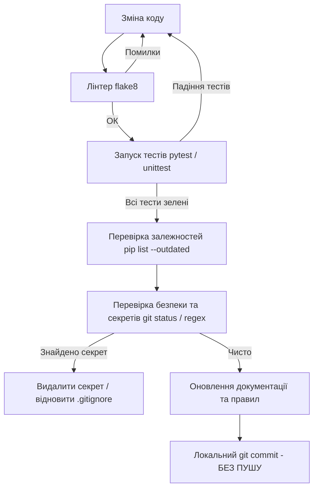

# 🤖 AGENTS.md — Інструкції та Правила для ШІ-Агентів

Цей документ визначає стандарти розробки, обмеження безпеки, операційний протокол та архітектурні орієнтири для розробників та ШІ-агентів, які працюють із репозиторієм **edus_calendar_sync**.

---

## 📌 1. Огляд Проєкту

**edus_calendar_sync** — сервіс автоматизованої синхронізації шкільного життя (портал [Edus.school](https://edus.school)) із **Google Calendar**.
Сервіс функціонує автономно (через GitHub Actions) або локально (через CLI), забезпечуючи перенесення:
1. **Розкладу уроків**: точний час, назва предмету, вчитель, кольорове кодування за предметом, тематичні емодзі.
2. **Шкільного меню**: прив'язка страв (сніданки, обіди, вечері) до подій розкладу.
3. **Канікул та вихідних**: автоматичне визначення періодів відпочинку та літніх канікул.
4. **Smart Auth**: безпечна ротація токенів доступу (JWT) та оновлення секретів через GitHub CLI.
5. **Моніторингу та алертингу**: Healthchecks.io пінг-сигнали та Telegram сповіщення.

---

## 🛡️ 2. Суворі Обмеження Безпеки (Safety Rules)

ШІ-агент **ЗАКРИТИЧНО ЗОБОВ'ЯЗАНИЙ** неухильно дотримуватися наступних правил:

### ⛔ 2.1. Заборона на пуш та публікацію
- **НІКОЛИ НЕ ВИКОНУЙ `git push`** і не заливай код на віддалений сервер, якщо немає окремої прямої команди користувача.
- Усі коміти створюються **виключно локально** (`git commit`).
- Заборонено створювати релізи, теги або синхронізувати форки без прямої згоди.

### 🔐 2.2. Запобігання витоку секретів (Zero-Leak Policy)
- **Ніколи не додавай у коміти чи код:**
  - Реальні Google Service Account JSON ключі (`private_key`).
  - Реальні токени Edus.school (Access JWT, Refresh Token).
  - Паролі або логіни користувачів.
  - Токени GitHub PAT (`ghp_...`, `github_pat_...`).
  - Токени Telegram ботів (`TELEGRAM_BOT_TOKEN`).
  - Healthchecks UUID.
- Файли `.env`, `.env.local`, `.env.*.local`, `output.log`, `keepalive.txt` внесені в `.gitignore` і **НІКОЛИ не повинні бути затрекані гітом**.
- Для прикладів конфігурації використовується виключно `.env.example` із безпечними плейсхолдерами.

### 🧪 2.3. Принцип обов'язкової верифікації
- Після будь-якої зміни в коді **ОБОВ'ЯЗКОВО**:
  1. Запускати лінтер: `.venv/bin/flake8 sync.py tests --max-line-length=130`.
  2. Проганяти тести: `.venv/bin/pytest tests -v` (або `python3 -m unittest discover tests`).
  3. Перевіряти актуальність залежностей: `.venv/bin/pip list --outdated`.
  4. Перевіряти `git status` та дифф на відсутність секретів перед формуванням коміту.

---

## 🛠️ 3. Робочий Процес Агента (Workflow Protocol)

Після завершення кожного логічного блоку коду агент діє за алгоритмом:



### Команди перевірки:
```bash
# 1. Форматування та лінтинг
.venv/bin/flake8 sync.py tests --max-line-length=130

# 2. Прогін тестів
.venv/bin/pytest tests -v

# 3. Звіт покриття коду тестами (мінімум 85%)
.venv/bin/coverage run -m pytest tests
.venv/bin/coverage report -m

# 4. Перевірка свіжості залежностей
.venv/bin/pip list --outdated

# 5. Перевірка статусу файлів
git status
```

---

## 🧩 4. Навички (Skills) в Проєкті

У каталозі `.agents/skills/` доступні спеціалізовані навички:
- [security-scanner](file:///.agents/skills/security-scanner/SKILL.md) — перевірка робочого дерева та коммітів на витоки ключів, токенів та паролів.
- [sync-verifier](file:///.agents/skills/sync-verifier/SKILL.md) — запуск комплексного пайплайну тестування, лінтингу та аналізу покриття.

Правила проєкту розташовані у `.agents/rules/`:
- [security.md](file:///.agents/rules/security.md) — політика ізоляції секретів та правила GitHub Actions.
- [development-workflow.md](file:///.agents/rules/development-workflow.md) — цикл розробки та вимоги до коммітів.

---

## 🏗️ 5. Архітектурні Принципи Коду

1. **Ізоляція оточення**:
   - Підтримка читання змінних як з середовища (`os.environ`), так і з файлів `.env.local` / `.env` через вбудований метод `load_dotenv_if_present()`.
2. **Вимоги до тестів**:
   - Будь-який зовнішній мережевий запит (Edus API, Google API, Telegram API) у тестах **повинен бути заміщений моком** (`unittest.mock.MagicMock` або `patch`).
   - Жоден юніт-тест не повинен ходити у реальний інтернет або потребувати реальних ключів.
3. **Обробка помилок та Rate Limiting**:
   - Google Calendar API повертає HTTP 403 / 429 при перевищенні квот. Обов'язковий експоненційний backoff (`wait = (2 ** n) + 1`).
   - При вичерпанні 5 спроб викидається зрозумілий `RuntimeError`.
   - Запити до Edus API повинні мати таймаути: `timeout=(10, 30)`.
4. **Стабільні ідентифікатори подій**:
   - Для розкладу: `sch<YYYYMMDD>n<order_num>` або `sch<YYYYMMDD>t<HHMM>`.
   - Для канікул: `hol<id>`.
   - Очищення старих або скасованих подій фільтрує лише події з префіксом `sch`, які відсутні у списку актуальних `active_ids`.

---

## 📝 6. Формат Комітів (Conventional Commits)

Використовуйте стандартний префікс:
- `feat:` нова функціональність.
- `fix:` виправлення дефекту або бага.
- `test:` додавання чи оновлення тестів.
- `refactor:` рефакторинг без зміни поведінки.
- `docs:` зміни в документації.
- `chore:` конфігурація, підтримка, залежності.

> **Важливо:** Не додавати до коміту файли `.env.local`, кеші `.pytest_cache`, `.coverage` тощо.
