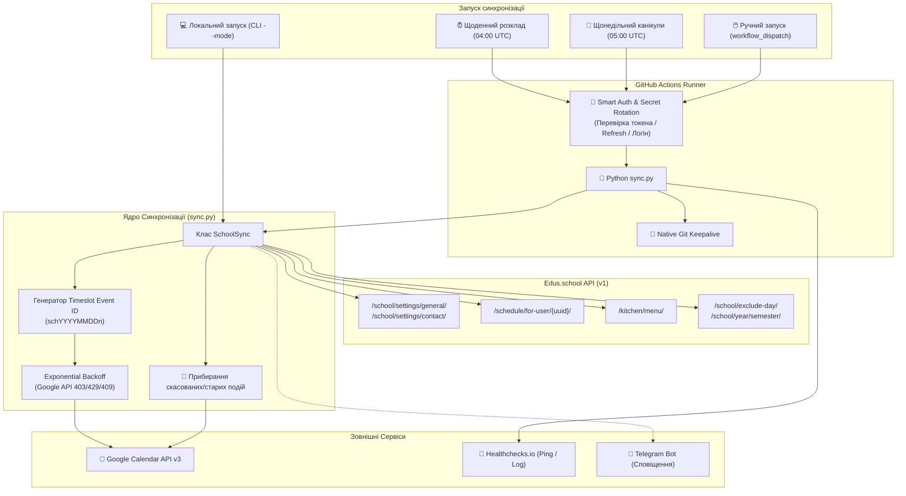

# 🏛️ Архітектура Системи Edus Calendar Sync

Цей документ детально описує внутрішню архітектуру, потік даних, структури синхронізації та механізми забезпечення надійності сервісу **edus_calendar_sync**.

---

## 1. Загальна Архітектура та Потік Даних

---

## 2. Модульна Архітектура та Розподіл Відповідальності

Архітектура побудована за принципом слабкої зв'язаності (loose coupling) та високої когезії (high cohesion):

### 2.1. `edus_client.py` — Автономний Клієнт Edus.school API
Повністю відокремлений клієнт, що не залежить від Google API:
- `login()`, `refresh_access_token()`, `get_parent_students()` — робота з обліковими записами.
- `get_school_location()` — отримання контактів та адреси школи.
- `get_lesson_list()`, `get_schedule()` — завантаження уроків та розкладу.
- `get_canteen_menu()`, `get_exclude_days()`, `get_semesters()` — меню та календарні події.

### 2.2. `calendar_client.py` — Клієнт Google Calendar API
Ізолює всю взаємодію з Google Calendar API v3:
- Авторизація через Service Account JSON.
- `upsert_event()` — інтелектуальне створення/оновлення подій із захистом від rate limit через 5-ступеневий Exponential Backoff (HTTP 403/429) та автоматичним переходом на `update` при HTTP 409.
- `delete_event()`, `list_events()` — базові операції над подіями.
- `cleanup_events()` — автоматичне очищення застарілих або скасованих подій за префіксом.

### 2.3. `calendar_mapper.py` — Трансформація та Форматування Даних
Чисті функції для перетворення моделей предметної області:
- `get_subject_emoji()` — маппінг понад 20 шкільних предметів на емодзі.
- `get_lesson_color_id()` — стабільний колірний хеш `obj_id % 11 + 1`.
- `build_schedule_event_id()` — створення стабільних дедуплікованих ID слотів (`schYYYYMMDDn<num>`).
- `map_schedule_item_to_event()` — інтеграція страв меню, локації та прихованих властивостей `extendedProperties`.
- `map_holiday_to_event()` — форматування канікул у прозорі події на весь день.

### 2.4. `sync_service.py` — Координатор Кроків Синхронізації
Керує покроковим пайплайном виконання, не містить прямого коду HTTP чи Google API:
- **Крок розкладу (`sync_schedule`)**:
  1. Розрахунок діапазону тижнів (поточний + N наступних).
  2. Завантаження меню їдальні через `EdusClient`.
  3. Завантаження розкладу на кожен тиждень.
  4. Трансформація записів через `calendar_mapper`.
  5. Запис подій у Google Календар через `GoogleCalendarClient`.
  6. Прибирання скасованих слотів через `cleanup_events`.
- **Крок канікул (`sync_holidays`)**:
  1. Завантаження вихідних та семестрів.
  2. Розрахунок літніх канікул.
  3. Запис актуальних канікул у календар.

### 2.5. `notifier.py` — Сервіс Сповіщень
Ізольована відправка оперативних статусів та повідомлень про помилки у Telegram (`send_telegram_alert`).

### 2.6. `sync.py` — Головний CLI та Оркестратор
Тонкий модуль запуску:
- Завантажувач `.env.local` / `.env` для миттєвого локального запуску з термінала.
- CLI парсер (`--mode schedule|holidays`, `--weeks`).
- Фасадний клас `SchoolSync` для 100% зворотньої сумісності.

### 2.7. Принцип Ізоляції CI Воркера (GitHub & Healthchecks)
Код на Python **не займається** модифікацією GitHub Secrets чи відправкою Healthchecks-пінгів:
- Вся взаємодія з GitHub Secrets (`gh secret set`) та моніторингом (`curl hc-ping.com`) винесена **виключно у CI воркер** (`.github/workflows/sync.yml`).
- Це дозволяє безпечно запускати `sync.py` локально на комп'ютері розробника без прив'язки до інфраструктури GitHub.

---

## 3. Алгоритми та Логіка Синхронізації

### 3.1. Стабільні Timeslot ID подій (Deduplication)
Google Calendar вимагає унікальний ідентифікатор `id` для кожної події (тільки латиниця в нижньому регістрі та цифри):
- Якщо є номер уроку (`order_num`):
  $$\text{eventId} = \text{sch} + \text{YYYYMMDD} + \text{n} + \text{order\_num}$$
  *(Наприклад: `sch20261020n1` для першого уроку на 20 жовтня 2026 року)*
- Якщо номер уроку відсутній (подія з точним часом):
  $$\text{eventId} = \text{sch} + \text{YYYYMMDD} + \text{t} + \text{HHMM}$$
  *(Наприклад: `sch20261020t1300` для обіду о 13:00)*
- Для канікул:
  $$\text{eventId} = \text{hol} + \text{sanitize(holiday\_id)}$$

**Перевага підходу**: при перейменуванні предмету або зміні вчителя подія не дублюється, а коректно оновлюється за існуючим `eventId`.

### 3.2. Інтеграція Меню Їдальні
Під час створення подій із назвами «Сніданок», «Обід» або «Вечеря» сервіс:
1. Завантажує структуру меню за маршрутом `/api/v1/kitchen/menu/`.
2. Знаходить день тижня (`week_day`).
3. Витягує перелік страв для конкретної назви події.
4. Додає перелік страв безпосередньо в поле `description` події Google Календаря.

### 3.3. Візуальна Ідентифікація (Кольори та Emoji)
- **Emoji-маппінг**: словник `SUBJECT_EMOJIS` містить понад 20 предметів (Математика: 🧮, Мова: 🇺🇦, English: 🇬🇧, Science: 🔬 тощо).
- **Кольори Google Calendar API**: підтримуються `colorId` від `1` до `11`. Для кожного уроку колір обчислюється як:
  $$\text{colorId} = \left(\text{int}(\text{obj\_id}) \pmod{11}\right) + 1$$
  Це гарантує, що однаковий предмет завжди матиме один і той самий стабільний колір у календарі.

### 3.4. Захист від Rate Limits Google Calendar API
При високій частоті запитів Google Calendar API повертає HTTP 403 (`rateLimitExceeded`) або 429 (`tooManyRequests`).
Система реалізує:
1. Обов'язкову мікро-паузу між запитами (`rate_limit_delay = 0.5s`).
2. Експоненційний Backoff на 5 спроб:
   $$\text{wait} = 2^n + 1 \quad (n \in [0..4] \implies 2, 3, 5, 9, 17 \text{ секунд})$$
3. При конфлікті HTTP 409 (`alreadyExists`) сервіс автоматично перемикається на виклик методу `update`.

---

## 4. Специфікація API Edus.school

| Маршрут | Метод | Призначення |
| --- | --- | --- |
| `/api/v1/user/token-refresh/` | POST | Оновлення access токена за refresh токеном |
| `/api/v1/user/login/` | POST | Повний логін за логіном і паролем батьків |
| `/api/v1/student/parent-student/{uuid}/` | GET | Отримання списку дітей та їхніх student UUID |
| `/api/v1/school/settings/general/` | GET | Загальні налаштування школи (назва) |
| `/api/v1/school/settings/contact/` | GET | Контактні дані школи (адреса, місто) |
| `/api/v1/student/lesson-list/{uuid}/` | GET | Список предметів учня |
| `/api/v1/schedule/for-user/{uuid}/` | GET | Розклад на тиждень (параметр `start_date`) |
| `/api/v1/kitchen/menu/` | GET | Меню шкільної їдальні на дні тижня |
| `/api/v1/school/exclude-day/` | GET | Графік канікул та вихідних днів |
| `/api/v1/school/year/semester/` | GET | Дати початку та закінчення навчальних семестрів |

---

## 5. Безпека та Захист від Вимкнення (Keepalive)

- **Smart Secret Update**: GitHub Actions самостійно оновлює `SCHOOL_TOKEN`, `SCHOOL_REFRESH_TOKEN` та `SCHOOL_USER_UUID` у сховищі GitHub Secrets, використовуючи Fine-grained PAT.
- **Native Git Keepalive**: GitHub автоматично вимикає scheduled workflows у публічних репозиторіях через 60 днів бездіяльності в гілках. Воркфлоу проєкту автоматично оновлює файл `keepalive.txt` у виділеній гілці `keep-alive-sync`, запобігаючи зупинці синхронізації.
- **Healthchecks.io Heartbeats**: Скрипт шле пінги `/start`, `/` (успіх) та `/fail` (з прикріпленням повного логу помилки).
