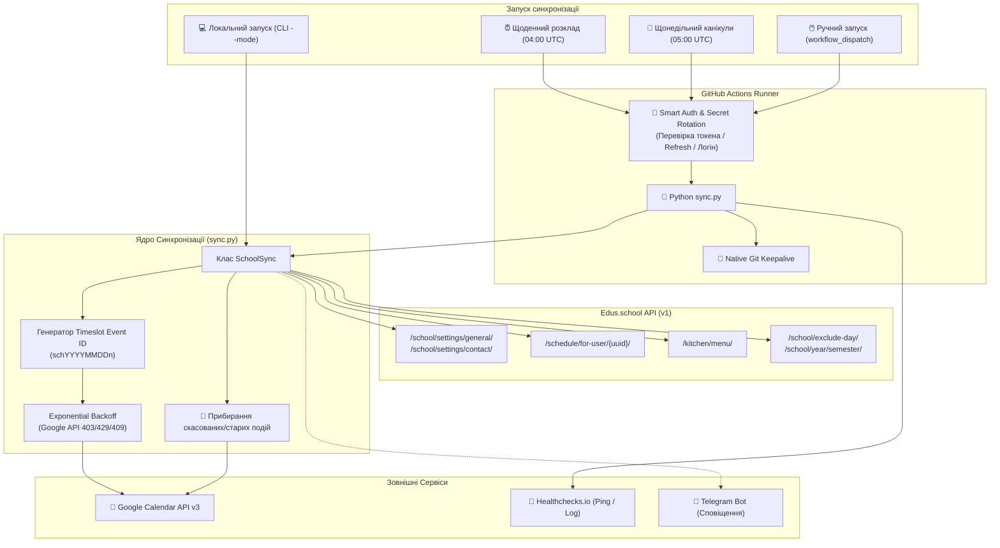

# 🏛️ Архітектура Системи Edus Calendar Sync

Цей документ детально описує внутрішню архітектуру, потік даних, структури синхронізації та механізми забезпечення надійності сервісу **edus_calendar_sync**.

---

## 1. Загальна Архітектура та Потік Даних

---

## 2. Ключові Модулі та Компоненти

### 2.1. `sync.py` — Головний Скрипт
- **`load_dotenv_if_present()`**:
  Автоматично завантажує змінні з `.env.local` або `.env` для локальної розробки без сторонніх бібліотек.
- **`SchoolSync`**:
  Основний клас синхронізації:
  - `fetch_data(path, params)`: робить запити до Edus API з таймаутами та обробкою JSON.
  - `get_school_location()`: динамічно отримує та кешує назву і адресу школи для додавання в поле `location` подій календаря.
  - `sync_schedule_flow()`: імпортує розклад на поточний та наступний тиждень, додає страви з меню, призначає кольори та емодзі, викликає очищення.
  - `sync_holidays()`: синхронізує канікули та формує подію літніх канікул на основі дати завершення 2-го семестру.
  - `cleanup_old_events()`: знаходить усі події з префіксом `sch` у діапазоні дат та видаляє ті, яких більше немає в розкладі.
  - `upsert_event()`: створює або оновлює подію з обробкою конфліктів (HTTP 409) та експоненційною затримкою при лімітах Google (HTTP 403/429).
  - `send_telegram_alert(message)`: відправляє сповіщення про статус роботи.

---

## 3. Алгоритми та Логіка Синхронізації

### 3.1. Стабільні Timeslot ID подій (Deduplication)
Google Calendar вимагає унікальний ідентифікатор `id` для кожної події (тільки латиниця в нижньому регістрі та цифри):
- Якщо є номер уроку (`order_num`):
  $$\text{eventId} = \text{sch} + \text{YYYYMMDD} + \text{n} + \text{order\_num}$$
  *(Наприклад: `sch20261020n1` для першого уроку на 20 жовтня 2026 року)*
- Якщо номер уроку відсутній (подія з точним часом):
  $$\text{eventId} = \text{sch} + \text{YYYYMMDD} + \text{t} + \text{HHMM}$$
  *(Наприклад: `sch20261020t1300` для обіду о 13:00)*
- Для канікул:
  $$\text{eventId} = \text{hol} + \text{sanitize(holiday\_id)}$$

**Перевага підходу**: при перейменуванні предмету або зміні вчителя подія не дублюється, а коректно оновлюється за існуючим `eventId`.

### 3.2. Інтеграція Меню Їдальні
Під час створення подій із назвами «Сніданок», «Обід» або «Вечеря» сервіс:
1. Завантажує структуру меню за маршрутом `/api/v1/kitchen/menu/`.
2. Знаходить день тижня (`week_day`).
3. Витягує перелік страв для конкретної назви події.
4. Додає перелік страв безпосередньо в поле `description` події Google Календаря.

### 3.3. Візуальна Ідентифікація (Кольори та Emoji)
- **Emoji-маппінг**: словник `SUBJECT_EMOJIS` містить понад 20 предметів (Математика: 🧮, Мова: 🇺🇦, English: 🇬🇧, Science: 🔬 тощо).
- **Кольори Google Calendar API**: підтримуються `colorId` від `1` до `11`. Для кожного уроку колір обчислюється як:
  $$\text{colorId} = \left(\text{int}(\text{obj\_id}) \pmod{11}\right) + 1$$
  Це гарантує, що однаковий предмет завжди матиме один і той самий стабільний колір у календарі.

### 3.4. Захист від Rate Limits Google Calendar API
При високій частоті запитів Google Calendar API повертає HTTP 403 (`rateLimitExceeded`) або 429 (`tooManyRequests`).
Система реалізує:
1. Обов'язкову мікро-паузу між запитами (`rate_limit_delay = 0.5s`).
2. Експоненційний Backoff на 5 спроб:
   $$\text{wait} = 2^n + 1 \quad (n \in [0..4] \implies 2, 3, 5, 9, 17 \text{ секунд})$$
3. При конфлікті HTTP 409 (`alreadyExists`) сервіс автоматично перемикається на виклик методу `update`.

---

## 4. Специфікація API Edus.school

| Маршрут | Метод | Призначення |
| --- | --- | --- |
| `/api/v1/user/token-refresh/` | POST | Оновлення access токена за refresh токеном |
| `/api/v1/user/login/` | POST | Повний логін за логіном і паролем батьків |
| `/api/v1/student/parent-student/{uuid}/` | GET | Отримання списку дітей та їхніх student UUID |
| `/api/v1/school/settings/general/` | GET | Загальні налаштування школи (назва) |
| `/api/v1/school/settings/contact/` | GET | Контактні дані школи (адреса, місто) |
| `/api/v1/student/lesson-list/{uuid}/` | GET | Список предметів учня |
| `/api/v1/schedule/for-user/{uuid}/` | GET | Розклад на тиждень (параметр `start_date`) |
| `/api/v1/kitchen/menu/` | GET | Меню шкільної їдальні на дні тижня |
| `/api/v1/school/exclude-day/` | GET | Графік канікул та вихідних днів |
| `/api/v1/school/year/semester/` | GET | Дати початку та закінчення навчальних семестрів |

---

## 5. Безпека та Захист від Вимкнення (Keepalive)

- **Smart Secret Update**: GitHub Actions самостійно оновлює `SCHOOL_TOKEN`, `SCHOOL_REFRESH_TOKEN` та `SCHOOL_USER_UUID` у сховищі GitHub Secrets, використовуючи Fine-grained PAT.
- **Native Git Keepalive**: GitHub автоматично вимикає scheduled workflows у публічних репозиторіях через 60 днів бездіяльності в гілках. Воркфлоу проєкту автоматично оновлює файл `keepalive.txt` у виділеній гілці `keep-alive-sync`, запобігаючи зупинці синхронізації.
- **Healthchecks.io Heartbeats**: Скрипт шле пінги `/start`, `/` (успіх) та `/fail` (з прикріпленням повного логу помилки).
